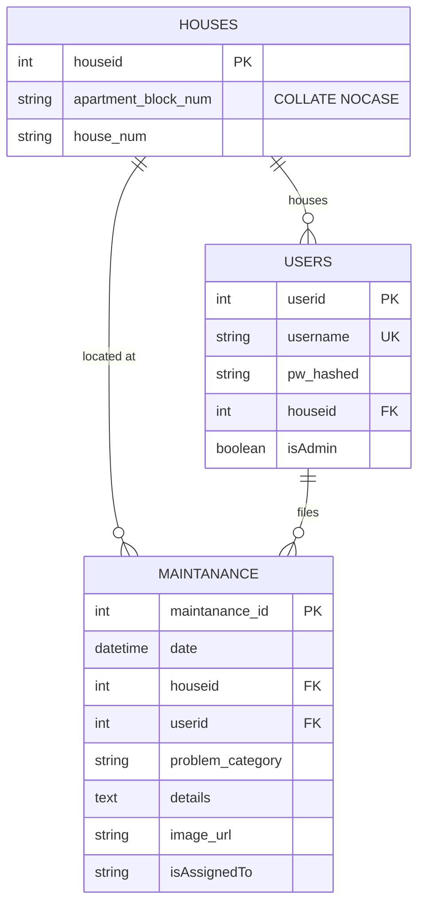

# 🏠 PropertyCare - Property Maintenance Tracking API & Portal

[](https://fastapi.tiangolo.com)
[](https://www.python.org/)
[](https://www.sqlalchemy.org/)
[](https://aws.amazon.com/s3/)
[](https://getbootstrap.com/)
[](https://docs.pytest.org/)
[](LICENSE)

A modular **FastAPI** web application and portal built for residential property maintenance management. The platform empowers residents to upload maintenance issues (with photo evidence stored in **AWS S3**) and provides administrators with an oversight console to manage requests and assign technicians to resolve them.

---

## 🌟 Key Features

- **Unified Authentication**: Single login endpoint (`/auth/login`) for both residents and administrators.
- **Pre-Seeded Admin**: Administrator credentials are automatically seeded on application startup via `.env`.
- **Resident Registration**: Residents register with username, password, apartment block name (case-insensitive), and flat number.
- **Relational Integrity**: Automatic case-insensitive matching ensures `"Block A"`, `"block a"`, and `"BLOCK A"` all link to the exact same house entity.
- **AWS S3 Image Storage**: Direct image upload pipeline with automatic UUID keying and MIME-type validation. Seamless local storage mock for offline development.
- **Role-Based Protection**: Strict permission checks (`get_current_user`, `get_current_admin`) safeguarding user and administrative operations.
- **Admin Assignment Workflow**: Administrators can filter tickets, inspect evidence, and assign staff members (`isAssignedTo`) to resolve issues.
- **Integrated Web Frontend**: Clean, responsive single-page web UI built with **HTML5, Bootstrap 5.3, and Vanilla JavaScript** served directly at `http://127.0.0.1:8000/`.
- **Cyberpunk 404 Defense Room**: Animated, surveillance-themed 404 security portal with interactive easter eggs to keep unauthorized visitors at bay.
- **Comprehensive Automated Tests**: 18 automated test cases covering authentication, permissions, S3 image uploads, case-insensitivity, and error handling.

---

## 🏗️ System Architecture

```
lab9/
├── app/
│   ├── config.py             # Pydantic Settings reading from .env
│   ├── database.py           # SQLAlchemy SQLite engine & session factory
│   ├── dependencies.py       # Auth guards: get_current_user, get_current_admin
│   ├── main.py               # FastAPI entrypoint, lifespan, router mounting
│   ├── models/               # SQLAlchemy ORM database models
│   │   ├── house.py          # houses table (houseid, apartment_block_num, house_num)
│   │   ├── user.py           # users table (userid, username, pw_hashed, houseid, isAdmin)
│   │   └── maintenance.py    # maintanance table (maintanance_id, date, image_url, isAssignedTo...)
│   ├── routers/              # API Route controllers
│   │   ├── auth.py           # /auth/register, /auth/login, /auth/me
│   │   ├── maintenance.py    # /maintenance resident endpoints
│   │   └── admin.py          # /admin management & assignment endpoints
│   ├── schemas/              # Pydantic DTOs & request/response validation
│   └── services/             # Business services (bcrypt hashing, JWT, AWS S3)
├── static/
│   ├── index.html            # Web Frontend (Bootstrap 5.3 + Vanilla JS)
│   └── 404.html              # Custom Animated Cyberpunk 404 Page
├── tests/                    # Pytest automated test suite (18 tests)
│   ├── conftest.py
│   ├── test_404.py
│   ├── test_admin.py
│   ├── test_auth.py
│   └── test_maintenance.py
├── .env.example              # Environment variables template
├── .env                      # Active local configuration
├── documentation.md          # Full architectural and API technical guide
├── LICENSE                   # MIT License
├── pytest.ini                # Pytest configuration
└── requirements.txt          # Project dependencies
```

---

## 🗄️ Database Schema

The database uses SQLite via SQLAlchemy with 3 tables:



---

## 🚀 Quick Start

### 1. Prerequisites
- Python 3.12+ installed.
- (Optional) AWS account with an S3 bucket configured if uploading to real AWS S3.

### 2. Setup Virtual Environment
```bash
# Windows PowerShell
python -m venv .venv
.\.venv\Scripts\Activate.ps1

# Linux / macOS
python3 -m venv .venv
source .venv/bin/activate
```

### 3. Install Dependencies
```bash
pip install -r requirements.txt
```

### 4. Configure Environment
Copy `.env.example` to `.env`:
```bash
cp .env.example .env
```
Default `.env` settings will work immediately for local offline testing (local S3 mock mode is enabled by default).

### 5. Start the Server
```bash
uvicorn app.main:app --reload --host 127.0.0.1 --port 8000
```

---

## 🌐 Endpoints & Pages

| Route | Method | Access | Description |
|---|---|---|---|
| `/` | `GET` | Public | Interactive Web Portal (`static/index.html`) |
| `/docs` | `GET` | Public | Swagger UI Interactive API Documentation |
| `/redoc` | `GET` | Public | ReDoc Interactive API Documentation |
| `/404` | `GET` | Public | Custom Animated 404 Surveillance Room |
| `/health` | `GET` | Public | Health status & storage mode |
| `/auth/register` | `POST` | Public | Register resident (username, pw, block, flat) |
| `/auth/login` | `POST` | Public | Unified login (JSON or Form) &rarr; JWT token |
| `/auth/me` | `GET` | Authenticated | Current user profile |
| `/maintenance` | `POST` | Resident | Upload maintenance issue with photo |
| `/maintenance/my` | `GET` | Resident | List resident's submitted tickets |
| `/maintenance/{id}` | `GET` | Owner/Admin | View specific ticket |
| `/admin/maintenance` | `GET` | Admin Only | List all tickets (filter by status, category, block) |
| `/admin/maintenance/{id}/assign` | `PATCH` | Admin Only | Assign staff/technician to ticket (`isAssignedTo`) |
| `/admin/users` | `GET` | Admin Only | List all registered users |
| `/admin/houses` | `GET` | Admin Only | List all registered property units |
| `/admin/stats` | `GET` | Admin Only | System metrics & ticket breakdown |

---

## 🧪 Running the Test Suite

The automated test suite runs in-memory with automatic upload isolation:

```bash
pytest -v
```

All 18 tests verify registration, authentication, RBAC, AWS S3 image storage, case-insensitivity, and custom 404 responses.

---

## ☁️ AWS Deployment

For AWS EC2 / ECS deployment instructions and IAM bucket policy setup, consult [`documentation.md`](documentation.md).

---

## 📄 License

This project is licensed under the [MIT License](LICENSE).
