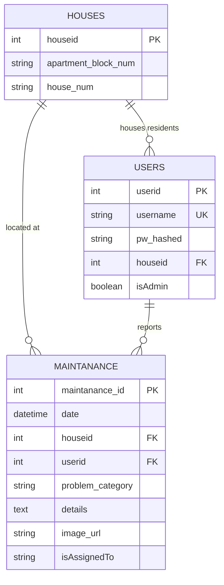

# Property Maintenance Tracking API Documentation

A modern, modular FastAPI application designed for residential property maintenance management. The platform enables residents to report household and building issues (with photo evidence uploaded directly to AWS S3) and provides administrators with a dedicated interface to monitor, manage, and assign technicians to resolve tickets.

---

## Table of Contents

1. [Architecture Overview](#architecture-overview)
2. [Database Schema &amp; Design](#database-schema--design)
   - [ER Diagram](#er-diagram)
   - [Tables &amp; Columns](#tables--columns)
3. [Environment Variables &amp; Configuration](#environment-variables--configuration)
4. [Authentication &amp; Authorization](#authentication--authorization)
   - [Admin Pre-seeding](#admin-pre-seeding)
   - [Unified Login](#unified-login)
   - [Role-Based Access Control (RBAC)](#role-based-access-control-rbac)
5. [AWS S3 Integration for Image Uploads](#aws-s3-integration-for-image-uploads)
6. [API Endpoints Reference](#api-endpoints-reference)
   - [Authentication Endpoints](#authentication-endpoints)
   - [Resident Maintenance Endpoints](#resident-maintenance-endpoints)
   - [Admin Management Endpoints](#admin-management-endpoints)
   - [System Endpoints](#system-endpoints)
7. [Running the Application](#running-the-application)
   - [Local Development Setup](#local-development-setup)
   - [Running Tests](#running-tests)
   - [AWS Hosting Guide](#aws-hosting-guide)

---

## Architecture Overview

The codebase is organized following clean architecture and FastAPI production best practices:

```
lab9/
├── app/
│   ├── __init__.py
│   ├── config.py             # Pydantic Settings & environment variables
│   ├── database.py           # SQLAlchemy SQLite engine & session dependency
│   ├── dependencies.py       # Auth dependencies (get_current_user, get_current_admin)
│   ├── main.py               # FastAPI app, lifespan, CORS, static mounting
│   ├── models/               # SQLAlchemy ORM database models
│   │   ├── __init__.py
│   │   ├── house.py          # houses table model
│   │   ├── user.py           # users table model
│   │   └── maintenance.py    # maintanance table model
│   ├── routers/              # API Route controllers
│   │   ├── __init__.py
│   │   ├── auth.py           # /auth/register, /auth/login, /auth/me
│   │   ├── maintenance.py    # /maintenance routes for residents
│   │   └── admin.py          # /admin routes for management & assignment
│   ├── schemas/              # Pydantic validation models (DTOs)
│   │   ├── __init__.py
│   │   ├── auth.py           # Token, LoginRequest, RegisterRequest
│   │   ├── house.py          # HouseBase, HouseResponse
│   │   ├── maintenance.py    # MaintenanceCreate, MaintenanceAssign, MaintenanceResponse
│   │   └── user.py           # UserResponse
│   └── services/             # Business logic & 3rd-party integrations
│       ├── __init__.py
│       ├── auth.py           # bcrypt password hashing & JWT token handling
│       └── s3.py             # AWS S3 image upload & local fallback mock
├── static/
│   └── index.html            # Web Frontend (HTML5, Bootstrap 5.3, Vanilla JS)
├── tests/                    # End-to-end automated test suite (pytest)
│   ├── conftest.py
│   ├── test_admin.py
│   ├── test_auth.py
│   └── test_maintenance.py
├── .env.example              # Environment variables template
├── .env                      # Active environment settings
├── documentation.md          # Comprehensive technical documentation
├── pytest.ini                # Pytest configuration
└── requirements.txt          # Project dependencies
```

---

## Database Schema & Design

The application uses **SQLAlchemy ORM** with **SQLite** (`maintenance.db`). The relational design consists of exactly three tables as specified: `users`, `houses`, and `maintanance`.

### ER Diagram



### Tables & Columns

#### 1. `houses`

Stores individual residential flats/units across different apartment blocks.

- **`houseid`** (`INTEGER`, Primary Key, Autoincrement): Unique identifier for each house.
- **`apartment_block_num`** (`VARCHAR(50)`, Not Null, Case-Insensitive / `COLLATE NOCASE`): Name or number of the apartment block/tower (e.g., `"Block A"`, `"tower 2"`). Handled case-insensitively so that `"Block A"`, `"block a"`, and `"BLOCK A"` map to the same house.
- **`house_num`** (`VARCHAR(50)`, Not Null): Flat/Room number within that block (e.g., `"102"`, `"Penthouse 4"`).

#### 2. `users`

Stores all user accounts (residents and system administrators).

- **`userid`** (`INTEGER`, Primary Key, Autoincrement): Unique identifier for each user.
- **`username`** (`VARCHAR(100)`, Unique, Not Null, Indexed): Unique login handle.
- **`pw_hashed`** (`VARCHAR(255)`, Not Null): Salted bcrypt hash of the user's password.
- **`houseid`** (`INTEGER`, Foreign Key referencing `houses.houseid`, Nullable): The house where the resident lives. Null for administrators.
- **`isAdmin`** (`BOOLEAN`, Not Null, Default `False`): `True` for administrators, `False` for residents.

#### 3. `maintanance`

Stores all submitted maintenance requests and tracks technician assignment.

- **`maintanance_id`** (`INTEGER`, Primary Key, Autoincrement): Unique ticket identifier.
- **`date`** (`DATETIME`, Not Null, Default `UTC Now`): Timestamp when the ticket was filed.
- **`houseid`** (`INTEGER`, Foreign Key referencing `houses.houseid`, Not Null): Property location where maintenance is needed.
- **`userid`** (`INTEGER`, Foreign Key referencing `users.userid`, Not Null): Resident who logged the request.
- **`problem_category`** (`VARCHAR(100)`, Not Null, Indexed): Category of the problem (e.g., `"Plumbing"`, `"Electrical"`, `"AC / HVAC"`, `"Carpentry"`).
- **`details`** (`TEXT`, Not Null): Detailed text explanation provided by the resident.
- **`image_url`** (`VARCHAR(1024)`, Not Null): URL pointing to the photo stored in AWS S3 (or local mock).
- **`isAssignedTo`** (`VARCHAR(150)`, Nullable, Default `None`): Name or role of the technician/contractor assigned to work on the problem (e.g., `"Carlos - Lead Electrician"`). If `None`, the ticket is pending assignment.

---

## Environment Variables & Configuration

The application reads configuration through `app/config.py` using `pydantic-settings` from `.env`:

| Variable                        | Type    | Default                               | Description                                                            |
| ------------------------------- | ------- | ------------------------------------- | ---------------------------------------------------------------------- |
| `PROJECT_NAME`                | String  | `Property Maintenance Tracking API` | Name of the application                                                |
| `DEBUG`                       | Boolean | `True`                              | Debug mode toggle                                                      |
| `SECRET_KEY`                  | String  | *Required in Prod*                  | Secret key for JWT HS256 signature                                     |
| `ALGORITHM`                   | String  | `HS256`                             | JWT signature algorithm                                                |
| `ACCESS_TOKEN_EXPIRE_MINUTES` | Integer | `1440` (24h)                        | JWT expiration time in minutes                                         |
| `DATABASE_URL`                | String  | `sqlite:///./maintenance.db`        | SQLAlchemy database connection string                                  |
| `ADMIN_USERNAME`              | String  | `admin`                             | Username for pre-seeded administrator                                  |
| `ADMIN_PASSWORD`              | String  | `AdminSecurePassword123!`           | Password for pre-seeded administrator                                  |
| `AWS_ACCESS_KEY_ID`           | String  | `""`                                | AWS IAM access key with S3 PutObject permission                        |
| `AWS_SECRET_ACCESS_KEY`       | String  | `""`                                | AWS IAM secret key                                                     |
| `AWS_REGION`                  | String  | `us-east-1`                         | AWS S3 region                                                          |
| `AWS_S3_BUCKET_NAME`          | String  | `property-maintenance-bucket`       | Target AWS S3 bucket name                                              |
| `USE_LOCAL_S3_MOCK`           | Boolean | `True`                              | If`True`, stores images locally in `./uploads` for offline testing |
| `LOCAL_UPLOAD_DIR`            | String  | `./uploads`                         | Directory for local file storage when mock is active                   |

---

## Authentication & Authorization

### Admin Pre-seeding

During FastAPI's startup (`lifespan` handler in `app/main.py`), the database is checked for the admin account specified by `ADMIN_USERNAME` and `ADMIN_PASSWORD`.

- If the administrator does not exist, it is automatically created with `isAdmin=True` and `houseid=None`.
- The password is saved using salted **bcrypt** hashing.

### Unified Login

Both residents and admins log in through the same endpoint:

- **Endpoint**: `POST /auth/login`
- Accepts **JSON** payload (`{"username": "...", "password": "..."}`) or **Form-data** (native support for Swagger UI's **Authorize** modal).
- Validates the password against the bcrypt hash stored in the `users` table.
- Returns a signed JWT token containing claims: `{"sub": username, "user_id": userid, "is_admin": isAdmin}`.

### Role-Based Access Control (RBAC)

- **`get_current_user`**: Validates the Bearer token from the `Authorization: Bearer <token>` header, decodes the JWT, and loads the active user record from the database.
- **`get_current_admin`**: Verifies that `current_user.isAdmin == True`. If not, returns `403 Forbidden` with `"Access forbidden: Administrator privileges required."`.
- **Resident Security**: When viewing a ticket at `GET /maintenance/{maintanance_id}`, residents can only view tickets belonging to their own `userid`. Admins have permission to view all tickets.

---

## AWS S3 Integration for Image Uploads

When residents submit a maintenance ticket, they upload a photo of the defect (e.g. water leakage or damaged AC unit).

### Upload Workflow

1. Resident sends a `multipart/form-data` request with fields:
   - `problem_category` (String)
   - `details` (String)
   - `image` (Binary File: `.jpg`, `.jpeg`, `.png`, `.webp`, `.gif`)
2. `app/services/s3.py` validates:
   - File extension and MIME type.
   - File size (capped at 10MB).
3. **Storage Strategy**:
   - **Production (AWS S3)**: When `USE_LOCAL_S3_MOCK=False` and AWS credentials are set, `boto3.client('s3')` uploads the file to `s3://{AWS_S3_BUCKET_NAME}/maintenance-images/{uuid}.ext` with the appropriate `ContentType`.
   - The public S3 URL is returned: `https://{AWS_S3_BUCKET_NAME}.s3.{AWS_REGION}.amazonaws.com/maintenance-images/{uuid}.ext`.
   - **Local Mock (Offline/Development)**: When `USE_LOCAL_S3_MOCK=True`, the file is safely written to `./uploads/{uuid}.ext` and mounted statically at `/uploads/{uuid}.ext` so images can be viewed immediately in a web browser without AWS charges.

---

## API Endpoints Reference

### Authentication Endpoints

#### 1. Resident Registration

- **Route**: `POST /auth/register`
- **Auth Required**: No (Public)
- **Request Body** (`application/json`):
  ```json
  {
    "username": "sarah_miller",
    "password": "SecretPassword123!",
    "apartment_block_num": "Tower B",
    "house_num": "402"
  }
  ```
- **Response** (`201 Created`):
  ```json
  {
    "userid": 2,
    "username": "sarah_miller",
    "isAdmin": false,
    "houseid": 1,
    "house": {
      "houseid": 1,
      "apartment_block_num": "Tower B",
      "house_num": "402"
    }
  }
  ```

#### 2. Unified Login

- **Route**: `POST /auth/login`
- **Auth Required**: No (Public)
- **Request Body** (supports both JSON and Form Data):
  ```json
  {
    "username": "sarah_miller",
    "password": "SecretPassword123!"
  }
  ```
- **Response** (`200 OK`):
  ```json
  {
    "access_token": "eyJhbGciOiJIUzI1NiIsInR5cCI6IkpXVCJ9...",
    "token_type": "bearer",
    "user": {
      "userid": 2,
      "username": "sarah_miller",
      "isAdmin": false,
      "houseid": 1,
      "house": {
        "houseid": 1,
        "apartment_block_num": "Tower B",
        "house_num": "402"
      }
    }
  }
  ```

#### 3. Current User Profile

- **Route**: `GET /auth/me`
- **Auth Required**: Yes (Resident or Admin)
- **Header**: `Authorization: Bearer <access_token>`
- **Response** (`200 OK`): Returns current authenticated user profile.

---

### Resident Maintenance Endpoints

#### 1. Submit Maintenance Request

- **Route**: `POST /maintenance`
- **Auth Required**: Yes (Resident)
- **Header**: `Authorization: Bearer <access_token>`
- **Content-Type**: `multipart/form-data`
- **Form Fields**:
  - `problem_category`: `"Plumbing"`
  - `details`: `"Water leaking from pipe underneath the bathroom basin."`
  - `image`: *(Binary image file: jpg/png/webp)*
- **Response** (`201 Created`):
  ```json
  {
    "maintanance_id": 1,
    "date": "2026-09-20T12:45:00.000000Z",
    "houseid": 1,
    "userid": 2,
    "problem_category": "Plumbing",
    "details": "Water leaking from pipe underneath the bathroom basin.",
    "image_url": "https://property-maintenance-bucket.s3.us-east-1.amazonaws.com/maintenance-images/4a7f21be82.jpg",
    "isAssignedTo": null,
    "user": {
      "userid": 2,
      "username": "sarah_miller",
      "isAdmin": false,
      "houseid": 1,
      "house": {
        "houseid": 1,
        "apartment_block_num": "Tower B",
        "house_num": "402"
      }
    },
    "house": {
      "houseid": 1,
      "apartment_block_num": "Tower B",
      "house_num": "402"
    }
  }
  ```

#### 2. View My Maintenance Requests

- **Route**: `GET /maintenance/my`
- **Auth Required**: Yes (Resident)
- **Header**: `Authorization: Bearer <access_token>`
- **Response** (`200 OK`): Array of maintenance tickets created by the logged-in resident.

#### 3. View Specific Ticket Details

- **Route**: `GET /maintenance/{maintanance_id}`
- **Auth Required**: Yes (Ticket Owner or Admin)
- **Header**: `Authorization: Bearer <access_token>`
- **Response** (`200 OK`): Details of ticket `#maintanance_id`. Returns `403 Forbidden` if another resident attempts to inspect it.

---

### Admin Management Endpoints

All admin endpoints require an active token with `isAdmin == True`.

#### 1. Oversee All Maintenance Requests

- **Route**: `GET /admin/maintenance`
- **Auth Required**: Yes (Admin only)
- **Header**: `Authorization: Bearer <admin_token>`
- **Optional Query Parameters**:
  - `is_assigned=true` or `is_assigned=false`: Filter tickets that are assigned or awaiting assignment.
  - `problem_category=Plumbing`: Filter by keyword in problem category.
  - `houseid=1`: Filter by specific house ID.
- **Response** (`200 OK`): List of all maintenance tickets matching criteria.

#### 2. Assign Technician to Problem

- **Route**: `PATCH /admin/maintenance/{maintanance_id}/assign`
- **Auth Required**: Yes (Admin only)
- **Header**: `Authorization: Bearer <admin_token>`
- **Request Body** (`application/json`):
  ```json
  {
    "isAssignedTo": "David (Senior Plumber - QuickFix Services)"
  }
  ```
- **Response** (`200 OK`):
  ```json
  {
    "maintanance_id": 1,
    "date": "2026-09-20T12:45:00.000000Z",
    "houseid": 1,
    "userid": 2,
    "problem_category": "Plumbing",
    "details": "Water leaking from pipe underneath the bathroom basin.",
    "image_url": "https://property-maintenance-bucket.s3.us-east-1.amazonaws.com/maintenance-images/4a7f21be82.jpg",
    "isAssignedTo": "David (Senior Plumber - QuickFix Services)",
    "user": { ... },
    "house": { ... }
  }
  ```

#### 3. List Registered Users

- **Route**: `GET /admin/users`
- **Auth Required**: Yes (Admin only)
- **Response** (`200 OK`): List of all registered users, their roles, and linked houses.

#### 4. List Registered Houses

- **Route**: `GET /admin/houses`
- **Auth Required**: Yes (Admin only)
- **Response** (`200 OK`): List of all registered blocks and flats.

#### 5. Dashboard Statistics

- **Route**: `GET /admin/stats`
- **Auth Required**: Yes (Admin only)
- **Response** (`200 OK`):
  ```json
  {
    "total_maintenance_requests": 14,
    "assigned_requests": 10,
    "unassigned_requests": 4,
    "total_houses": 8,
    "total_residents": 12
  }
  ```

---

### System Endpoints

- **`GET /`**: Welcome message, status, and direct links to `/docs` and `/redoc`.
- **`GET /health`**: Health status indicating database connection and storage mode (`mock_s3` or `aws_s3`).

---

## Running the Application

### Local Development Setup

1. **Activate the Virtual Environment**:

   - On Windows (PowerShell):
     ```powershell
     .\.venv\Scripts\activate
     ```
   - On Linux / macOS:
     ```bash

     source .venv/bin/activate
     ```
2. **Install Requirements**:

   ```bash
   pip install -r requirements.txt
   ```
3. **Configure Environment Variables**:
   Copy `.env.example` to `.env` if not already present:

   ```bash
   cp .env.example .env
   ```
4. **Launch the FastAPI Server**:

   ```bash
   uvicorn app.main:app --reload --host 127.0.0.1 --port 8000
   ```
5. **Access Interactive Documentation**:

   - **Swagger UI**: [http://127.0.0.1:8000/docs](http://127.0.0.1:8000/docs)

---

### Running Tests

The test suite runs with **pytest** against an isolated in-memory SQLite database:

```bash
pytest -v
```

All 13 test cases verify registration, bcrypt authentication, role enforcement, S3 image uploads, ticket assignment, and admin oversight.

---

---

## Web Frontend (Bootstrap 5 + Vanilla JS)

The application comes with an integrated, responsive single-page web frontend located at [`static/index.html`](<file:///D:/SNU/Semester%207/Big%20Data/Lab/lab9/static/index.html>) and served directly on `http://127.0.0.1:8000/`.

### Key Features:

1. **Unified Authentication Screen**:
   - **Login Tab**: Used by both residents and administrators. Features a "Quick Fill Admin" shortcut for evaluation testing.
   - **Resident Register Tab**: Allows new residents to enter their username, password, apartment block, and flat number.
2. **Resident Portal**:
   - **Maintenance Request Form**: Select problem category (Plumbing, Electrical, HVAC, etc.), describe the defect, and select a photo file with a real-time image preview before submitting.
   - **My Requests Feed**: Lists all tickets previously filed by the resident, showing date, photo thumbnail, problem description, and live assignment status (e.g., `Awaiting Assignment` or `Assigned to: Carlos (Plumber)`).
   - **Photo Viewer**: Clicking any photo thumbnail opens an interactive high-resolution modal with direct S3/storage links.
3. **Administrator Portal**:
   - **Metric Cards**: Real-time counters showing total tickets, unassigned tickets, assigned tickets, and registered residents.
   - **Filterable Ticket Board**: Filter tickets by assignment status (All, Pending, Assigned) with instant reload.
   - **Interactive Assignment Modal**: One-click modal to assign or reassign tickets to specific contractors or staff (`isAssignedTo`).
   - **Resident & Property Directories**: Full tables of registered residents, admin accounts, apartment blocks, and flat numbers.

---

### AWS Hosting Guide

When deploying to AWS (e.g., **AWS EC2**):

1. **Create an S3 Bucket**:

   - Name: `property-maintenance-bucket` (or any unique name).
   - Configure Public Access or Presigned URLs depending on your privacy policy.
   - Attach CORS configuration to allow GET requests from your web domain.
2. **IAM Policy for the Application**:
   Create an IAM Role with permissions for the bucket:

   ```json
   {
     "Version": "2012-10-17",
     "Statement": [
       {
         "Effect": "Allow",
         "Action": [
           "s3:PutObject",
           "s3:GetObject"
         ],
         "Resource": "arn:aws:s3:::property-maintenance-bucket/*"
       }
     ]
   }
   ```
3. **Set Production Environment Variables**:

   ```env
   USE_LOCAL_S3_MOCK=False
   AWS_REGION=us-east-1
   AWS_S3_BUCKET_NAME=property-maintenance-bucket
   AWS_ACCESS_KEY_ID=your-aws-access-key-id
   AWS_SECRET_ACCESS_KEY=your-aws-secret-access-key
   SECRET_KEY=generate-a-strong-256-bit-random-secret
   ADMIN_USERNAME=property_admin
   ADMIN_PASSWORD=A_Very_Strong_Admin_Password!
   ```
4. **Launch Server with Uvicorn**:

   ```bash
   uvicorn app.main:app --host 0.0.0.0 --port 80 --workers 4
   ```
